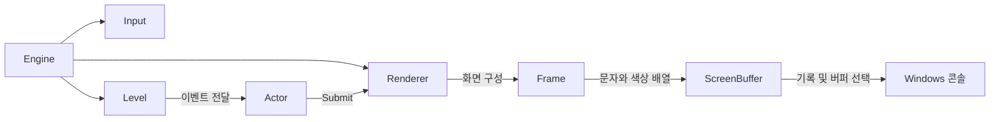

# CobraEngine

> **C++·WinAPI 기반 콘솔 게임 엔진**  
> 게임 객체의 수명 관리, 장면 관리, 입력 처리와 이중 버퍼링 렌더링을 직접 구현한 개인 프로젝트입니다.

언리얼 엔진의 **Actor·Level 중심 객체 관리 개념**을 참고해, 콘솔 환경에서 사용할 엔진 구조를 구현했습니다. 기능 구현에 더해 Actor 제거 방식을 개선하고, 부하 테스트로 처리 시간과 생존 객체의 순서 보존을 검증했습니다.

| 구분 | 내용 |
| --- | --- |
| 개발 환경 | Windows · Visual Studio 2022 · MSVC v143 · Windows SDK |
| 사용 기술 | C++ · STL · WinAPI |
| 프로젝트 구성 | `CobraEngine` 엔진 DLL + `CobraGame` 실행 프로그램 |
| 대표 성과 | Actor 10,000개 중 50% 제거 시 **24.77675ms → 0.09320ms**, 중앙값 기준 **99.62% 감소** |
| 현재 기본 실행 | **Actor 제거 성능 벤치마크** |

대표 성과는 [저장된 CSV](CobraGame/ActorRemovalBenchmark.csv)의 조건별 30회 측정값에서 계산한 **제거 구간의 결과**입니다.

## 바로 보기

- [주요 기능](#주요-기능)
- [엔진 구조와 실행 흐름](#엔진-구조와-실행-흐름)
- [Actor 제거 성능 개선](#actor-제거-성능-개선)
- [빌드와 실행](#빌드와-실행)
- [코드 구성](#코드-구성)
- [엔진 사용 예시](#엔진-사용-예시)

## 주요 기능

| 기능 | 구현 내용 | 코드 |
| --- | --- | --- |
| 게임 루프 | 고해상도 타이머로 경과 시간을 계산하고 입력·업데이트·그리기 순서 관리 | [Engine](CobraEngine/Engine/Engine.cpp) |
| 입력 처리 | 가상 키 코드 256개의 현재·이전 상태를 비교해 `GetKey`, `GetKeyDown`, `GetKeyUp` 제공 | [Input](CobraEngine/Core/Input.cpp) |
| 게임 객체 | 위치·문자열·색상·활성 상태와 `BeginPlay`, `Tick`, `Draw` 제공 | [Actor](CobraEngine/Actor/Actor.h) |
| 장면 관리 | Actor 생성, owner 연결, 이벤트 전달, 추가·제거 예약 처리 | [Level](CobraEngine/Level/Level.h) |
| 타입 확인 | 타입 ID와 상속 관계 검사, 검사 후 `shared_ptr` 형변환 | [Object](CobraEngine/Core/Object.h) |
| 렌더링 | 그리기 요청 수집, 화면 밖 문자 제외, 칸별 우선순위 비교, 최종 화면 구성 | [Renderer](CobraEngine/Render/Renderer.cpp) |
| 이중 버퍼링 | 두 Windows 콘솔 버퍼를 번갈아 작성·표시하고 종료 시 표준 출력 버퍼로 복귀 | [ScreenBuffer](CobraEngine/Render/ScreenBuffer.cpp) |
| 좌표·색상 | 정수형 2D 좌표 연산과 콘솔 글자 색상 정의 | [Vector2](CobraEngine/Math/Vector2.h) · [Color](CobraEngine/Math/Color.h) |

## 엔진 구조와 실행 흐름

### 구성 요소의 역할

- **Actor**: 캐릭터·사물처럼 게임에 등장하는 객체의 기반 클래스입니다.
- **Level**: 한 장면의 Actor들을 소유하고 실행 이벤트를 전달합니다.
- **Engine**: Input, Level, Renderer를 연결하고 실행 순서를 관리합니다.
- **Renderer**: Actor들의 요청으로 화면을 완성한 뒤 콘솔 버퍼에 기록하고 표시합니다.



### 한 프레임의 처리 순서

입력을 갱신하고 목표 프레임 간격이 지났는지 확인한 뒤, 다음 순서로 처리합니다. 목표 간격을 기다리는 동안에도 입력 갱신과 시간 확인은 반복됩니다.

```text
Level 초기화 여부 확인
→ 새 Actor의 BeginPlay
→ Actor들의 Tick(deltaTime)
→ Actor들의 Draw: 그리기 요청 제출
→ Renderer::Draw: 화면 구성·기록·표시
→ 요청된 Level 전환
→ Actor 추가·제거 예약 반영
→ 현재 입력 상태를 이전 상태로 저장
```

기본 설정은 **목표 60 FPS, 가로 60칸 × 세로 25칸**이며 [Engine.h](CobraEngine/Engine/Engine.h)의 `EngineSetting`에서 변경합니다. 실제 경과 시간을 Tick에 전달하는 방식으로, 고정된 시뮬레이션 간격을 강제하는 구조는 아닙니다.

### Actor 수명 관리

```text
SpawnActor<T>()
→ Actor 생성 및 owner 연결
→ 추가 요청 목록에 보관
→ 프레임 끝에 관리 목록 등록
→ BeginPlay → Tick / Draw
→ Destroy()로 제거 예약
→ 프레임 끝에 관리 목록에서 제거
```

순회 중인 vector가 변경되지 않도록 **요청과 목록 반영 시점을 분리**했습니다. `Destroy()`가 호출되면 실제 목록 제거 전에도 `IsActive()`가 false가 되어 업데이트와 그리기에서 제외됩니다.

- Engine은 Input과 Renderer를 `unique_ptr`로 소유합니다.
- Level은 Actor들을 `shared_ptr`로 소유합니다.
- Actor는 자신을 관리하는 Level을 `weak_ptr`로 참조해 순환 참조를 피합니다.
- 목록에서 제거된 Actor라도 다른 `shared_ptr` 소유자가 있으면 객체의 수명은 유지됩니다.

### 화면 구성과 이중 버퍼링

```text
Actor::Draw()
→ Submit()으로 RenderCommand 저장
→ Frame에 최종 문자·색상·우선순위 구성
→ 보이지 않는 콘솔 버퍼에 화면 전체 기록
→ 완성한 버퍼 표시
→ 다음에 작성할 버퍼 번호 변경
```

같은 칸에 여러 요청이 겹치면 **높은 우선순위의 요청**을 남기고, 우선순위가 같으면 **나중 요청**이 덮어씁니다. 따라서 Actor 순서를 보존하는 것은 동일 우선순위의 출력 결과를 유지하는 데도 의미가 있습니다.

## Actor 제거 성능 개선

### 문제와 원인

`Level::ProcessAddAndDestroyActors()`는 프레임 끝에 예약된 Actor 제거와 추가를 반영합니다. 기존 제거 코드는 대상을 발견할 때마다 `vector::erase()`를 호출해, 뒤의 포인터 원소들을 반복적으로 이동시켰습니다.

### 선택과 수정

매 프레임 전체 목록을 순회하는 기존 구조를 유지하면서 반복 이동을 줄이기 위해, **vector를 유지하고 제거 알고리즘을 변경**했습니다. 생존 Actor의 순서도 보존하도록 `std::remove_if`와 범위 `erase`를 사용했습니다.

```cpp
const auto newEnd = std::remove_if(
    m_actors.begin(),
    m_actors.end(),
    [](const std::shared_ptr<Actor>& actor)
    {
        return actor->HasExpired();
    }
);

m_actors.erase(newEnd, m_actors.end());
```

| 항목 | 수정 전 | 수정 후 |
| --- | --- | --- |
| 제거 방법 | 발견할 때마다 중간 `erase` | 생존 원소 압축 후 뒤 구간 `erase` |
| 생존 원소 이동 | 동일 원소가 여러 번 이동할 수 있음 | 각 생존 원소가 최대 한 번 이동 |
| 생존 순서 | 유지 | 유지 |
| 제거 단계의 최악 시간복잡도 | O(N²) | O(N) |
| 알고리즘의 추가 공간 | O(1) | O(1) |

위 복잡도는 컨테이너 처리 기준입니다. 실제 제거 시간에는 제거 대상 Actor의 소멸·메모리 정리 비용도 포함될 수 있습니다.

### 측정 방법

[CobraGame.cpp](CobraGame/CobraGame.cpp)에서 실제 Actor를 생성하고, 두 제거 알고리즘을 같은 실행 프로그램 안에서 비교합니다.

| 항목 | 조건 |
| --- | --- |
| Actor 수 | 1,000개 / 10,000개 |
| 제거 비율 | 0% / 50% / 100% |
| 50% 배치 | 인덱스가 홀수인 Actor를 제거 대상으로 지정 |
| 준비 실행 | 조건별 각 방식 5회 |
| 본 측정 | 조건별 각 방식 30회, 먼저 실행하는 방식을 번갈아 변경 |
| 시간 측정 | `QueryPerformanceCounter`, 단위 ms |
| 측정 구간 | 제거 함수 호출 구간 |
| 제외 구간 | Actor 생성, 제거 표시, 결과 검증, CSV 저장 |
| 정확성 검사 | 생존 개수와 포인터 순서를 기대 결과와 비교 |

매번 새로운 목록을 준비하며, 검증용 주소는 일반 포인터로 보관해 제거 대상의 소멸을 막지 않습니다. 타이머 구간에는 조건 검사, 원소 이동 및 제거 대상의 소멸·메모리 정리가 포함됩니다.

### 저장된 측정 결과

[ActorRemovalBenchmark.csv](CobraGame/ActorRemovalBenchmark.csv)의 **180개 행을 조건별로 묶어 계산한 30회 중앙값**입니다. 시간 단위는 ms입니다.

| Actor 수 | 제거 비율 | 수정 전 | 수정 후 | 시간 감소율 |
| ---: | ---: | ---: | ---: | ---: |
| 1,000 | 0% | 0.00070 | 0.00070 | 0.00% |
| 1,000 | 50% | 0.24775 | 0.00805 | 96.75% |
| 1,000 | 100% | 0.50560 | 0.02355 | 95.34% |
| 10,000 | 0% | 0.01055 | 0.01140 | -8.06% |
| **10,000** | **50%** | **24.77675** | **0.09320** | **99.62%** |
| 10,000 | 100% | 48.66115 | 0.23585 | 99.52% |

시간 감소율은 `(수정 전 중앙값 - 수정 후 중앙값) / 수정 전 중앙값 × 100`으로 계산했습니다. 음수는 수정 후 중앙값이 증가했다는 의미입니다.

Actor 수를 1,000개에서 10,000개로 늘린 50% 제거 조건에서, 기존 방식은 약 **100배**, 변경 방식은 약 **11.6배**의 시간 증가를 보였습니다. 반면 제거 대상이 없는 조건에서는 개선 효과가 없거나 작은 차이가 나타났습니다.

> 이 결과는 지정한 부하 조건의 **제거 처리 시간**입니다. 전체 게임 FPS나 다른 PC에서의 동일한 개선율을 의미하지 않습니다. CSV에는 CPU 모델·운영체제·빌드 구성 등의 환경 정보가 포함되어 있지 않으므로, 재측정 시 해당 정보를 함께 기록해야 합니다.

## 빌드와 실행

### 준비 환경

- Windows
- Visual Studio 2022의 **C++를 사용한 데스크톱 개발** 워크로드
- MSVC v143 및 Windows SDK

### 1. 저장소 받기

```bash
git clone https://github.com/JCBBBBBB/CobraEngine.git
cd CobraEngine
```

### 2. 솔루션과 구성 선택

1. 저장소 루트의 **`JJJ.sln`**을 엽니다.
2. **`Release / x64`**를 선택합니다.
3. 구성 관리자에서 두 프로젝트 모두 `Release / x64`인지 확인합니다.
4. **CobraGame**을 시작 프로젝트로 설정합니다.

엔진 DLL 설정이 있는 **x64 구성**을 사용합니다.

### 3. 다른 PC의 헤더 경로 설정

현재 `CobraGame.vcxproj`에는 개발 환경의 엔진 헤더 경로가 절대 경로로 저장되어 있습니다. 클론한 위치와 무관하게 빌드할 수 있도록 아래와 같이 변경합니다.

```text
CobraGame 프로젝트 우클릭 → 속성
구성: 모든 구성 / 플랫폼: x64
C/C++ → 일반 → 추가 포함 디렉터리
```

기존 엔진 절대 경로를 다음 값으로 교체하고, 상속된 설정은 유지합니다.

```text
$(SolutionDir)CobraEngine;%(AdditionalIncludeDirectories)
```

`CobraGame`에는 `CobraEngine` 프로젝트 참조가 이미 등록되어 있습니다. `COBRA_ENGINE_BUILD_DLL`은 엔진 프로젝트에서만 사용하는 공개 설정입니다.

### 4. 실행과 결과 확인

1. 솔루션을 빌드합니다.
2. **Ctrl + F5**로 실행합니다.
3. 조건별 `Before`, `After` 중앙값과 다음 메시지를 확인합니다.

```text
All count/order checks passed.
Saved: ActorRemovalBenchmark.csv
```

현재 실행 진입점은 벤치마크이므로, 실행하면 성능 결과가 출력됩니다. `before_ms`와 `after_ms`는 각각 기존 방식과 일괄 제거 방식의 경과시간입니다.

CSV는 실행 프로그램의 **작업 디렉터리**에 저장됩니다. 저장소의 `CobraGame` 폴더에 결과를 저장하려면 다음 값을 설정합니다.

```text
CobraGame 속성 → 구성 속성 → 디버깅 → 작업 디렉터리
$(ProjectDir)
```

새 측정 결과는 같은 이름의 CSV에 저장됩니다. 실행 파일을 별도로 실행할 때는 `CobraGame.exe`와 `CobraEngine.dll`을 같은 폴더에 둡니다.

## 코드 구성

```text
CobraEngine/
├─ JJJ.sln
├─ CobraEngine/                  # 엔진 DLL 프로젝트
│  ├─ Actor/                    # 게임 객체와 프레임 이벤트
│  ├─ Core/                     # 공개 매크로, 입력, 타입 확인
│  ├─ Engine/                   # 게임 루프와 시스템 수명 관리
│  ├─ Level/                    # 장면과 Actor 목록 관리
│  ├─ Math/                     # Vector2, Color
│  └─ Render/                   # 그리기 요청, Frame, 콘솔 버퍼
└─ CobraGame/                    # 실행·성능 측정 프로젝트
   ├─ CobraGame.cpp             # 현재 main 및 제거 벤치마크
   └─ ActorRemovalBenchmark.csv # 저장된 측정 결과
```

## 엔진 사용 예시

벤치마크 대신 엔진으로 장면을 실행하려면 `CobraGame.cpp`의 진입점을 아래처럼 구성할 수 있습니다. 예시는 `@`를 표시하고 ESC 입력으로 종료합니다.

<details>
<summary>최소 장면 실행 코드</summary>

```cpp
#include "Engine/Engine.h"
#include "Level/Level.h"
#include "Actor/Actor.h"
#include "Core/Input.h"
#include <Windows.h>

class DemoActor : public Actor
{
    TYPE_DECLARATIONS(DemoActor, Actor)

public:
    DemoActor()
        : Actor("@", Vector2(3, 3), Color::Yellow)
    {
    }

    void Tick(float deltaTime) override
    {
        if (Input::Get().GetKeyDown(VK_ESCAPE))
        {
            QuitGame();
        }
    }
};

class DemoLevel : public Level
{
public:
    void OnInitialized() override
    {
        Level::OnInitialized();
        SpawnActor<DemoActor>();
    }
};

int main()
{
    Engine engine;
    engine.AddNewLevel<DemoLevel>();
    engine.Run();
    return 0;
}
```

`Level`은 `shared_from_this()`를 사용하므로 `shared_ptr`로 관리해야 합니다. 위 예시에서는 `AddNewLevel()`이 내부에서 `make_shared`로 생성합니다. 또한 Actor가 그리기 요청을 보내기 전에 Engine이 Input과 Renderer를 생성합니다.

</details>
